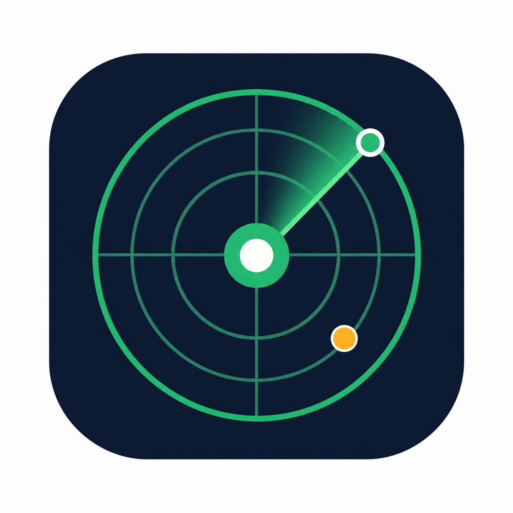

<div align="center">
  
  <h1>消息雷达</h1>
  <p><strong>自托管的 AI 公开信息监测平台：聚合 X、官方博客与 RSS/Atom，沉淀到 SQLite，并通过飞书 / 企业微信 / 钉钉 / Bark / 通用 Webhook / 微信推送。</strong></p>
  <p>
    <a href="#快速开始">快速开始</a>
    · <a href="#功能">功能</a>
    · <a href="#配置">配置</a>
    · <a href="#部署">部署</a>
    · <a href="#开发">开发</a>
    · <a href="#常见问题">常见问题</a>
  </p>
</div>

<p align="center">
  
  
  
  
  
  
  
</p>

## 简介

消息雷达面向个人开发者、研究者和需要持续跟踪 AI 动态的小团队。它把分散在 X、官方博客、RSS/Atom、GitHub Trending、HF Daily Papers 等来源的公开信息统一收集到本地 SQLite，再按订阅规则推送到常用的协作工具或个人微信，减少手动刷信息的时间。

项目采用本地优先设计：SQLite 是唯一状态中心，管理台和用户端由同一个服务提供；不依赖云数据库，本地运行不需要 Docker，服务器部署可使用 `deploy/` 下的 Compose 配置。

**English Summary:** Message Radar is a self-hosted monitor for public AI news sources. It polls X accounts, official blogs, RSS/Atom feeds, GitHub Trending, and HF Daily Papers; stores posts in SQLite; and delivers new items to Feishu, WeCom, DingTalk, Bark, generic webhooks, or WeChat with per-channel subscription rules. A built-in dashboard manages sources, source packs, messages, delivery, users, backups, and runtime logs.

## 项目边界

本项目只用于个人/小团队自托管的 AI 公开信息监测与多渠道通知，不做黑客攻击、不绕过登录、不破解验证码、不规避平台风控、不采集隐私数据、不批量滥用；不上传 Cookie、不保存 X 账号密码、不自动登录。浏览器模式只访问公开页面，遇到登录、限流、验证码或额外验证时不会绕过。

## 功能

| 能力 | 说明 |
| --- | --- |
| 多源监听 | X 账号、官方博客、RSS/Atom、GitHub Trending、HF Daily Papers；支持按来源类型添加 YouTube、Reddit、arXiv、Hacker News、Product Hunt |
| 增量与去重 | 新来源首轮只锚定最新 1 条，之后只收录新内容；榜单型来源首轮全量入库但不推送；稳定 ID + 去重键保证重复轮询幂等 |
| 主题包 | 管理员可建包、维护成员、排序、启停；用户可按「全部接收 / 按主题包 / 自定义」订阅 |
| 多渠道投递 | 飞书、企业微信、钉钉（支持加签）、Bark、通用 Webhook、微信（ClawBot），支持通道级订阅规则和失败重试 |
| 用户端 | 消息浏览、搜索、平台分类筛选、分页；微信绑定、夜间静默、按源/包过滤、推送额度提示 |
| 管理台 | 监听源、消息内容、轮询/发送历史、运行配置、用户与钉钉登录、备份与日志 |
| 数据自有 | Feed、帖子导出、数据库备份都从本地 SQLite 生成，不依赖外部服务 |

## 工作流程

```text
定时调度
  → SourceProvider 抓取 / 解析 / 标准化
  → 首轮基线 + 水位线 + 去重键
  → SQLite 入库
  → 订阅规则 + 主题包/按源过滤
  → 投递事件
  → 通道发送 / 失败重试 / 死信
  → 管理台、用户端、Feed 输出
```

几个关键设计：

- **源适配器**：每个来源实现统一的 `SourceProvider` 接口（抓取 → 解析 → 标准化 → 去重键），X、RSS、GitHub、HF 和官方博客共用同一条轮询、投递与规则链路。
- **基线与游标**：新来源首轮只建立基线，避免接入时被历史消息轰炸；之后按 `xPostId` 游标增量入库。
- **投递幂等**：投递事件按「帖子 + 通道」唯一，发送前抢占，失败按可重试性分类；支持夜间静默汇总和按主题包/源过滤。
- **本地优先**：SQLite 是唯一事实来源，管理台、Feed、导出和备份都从库内数据生成。

## 快速开始

### 环境要求

| 依赖 | 要求 |
| --- | --- |
| Node.js | `>= 20` |
| npm | 随 Node.js 安装 |
| 浏览器运行环境 | Playwright Chromium，由初始化命令安装 |
| 数据库 | SQLite 单文件数据库，无需单独安装 |
| Docker | 本地运行不需要；服务器部署可选 |
| Redis | 核心功能不强依赖；`/ready` 会检查 Redis，失败不影响管理台使用 |

### 初始化与启动

```bash
git clone git@github.com:shi-YangYang/AI-Frontier-Radar.git
cd AI-Frontier-Radar
npm run setup
npm run local
```

启动后打开：

```text
http://127.0.0.1:3000/
```

`npm run setup` 会检查 Node.js 版本、创建 `.env`、安装依赖、生成 Prisma Client、执行数据库迁移并安装 Playwright Chromium；任一步失败会立即停止。

`npm run local` 会读取 `.env`，执行 Prisma 生成、数据库迁移、前后端构建并启动服务。开发模式使用：

```bash
npm run dev
```

`npm run dev` 只监听后端源码变化，不会自动构建前端静态资源；改动前端后仍需执行 `npm run build` 或使用 `npm run local`。

### 首次登录

首次启动会自动创建管理员账号：

- 配置了 `ADMIN_USERNAME` / `ADMIN_PASSWORD` 时按其创建；
- 未配置 `ADMIN_PASSWORD` 时生成随机密码，并打印在启动日志中。

所有页面都需要登录：

| 入口 | 说明 |
| --- | --- |
| `/login` | 登录页；管理员登录后进入管理台，普通用户进入 `/portal` |
| `/portal` | 普通用户页：浏览消息、绑定微信、设置推送偏好 |
| `/settings` -> 用户 | 管理员创建/删除用户、重置密码；首个管理员由环境变量种子创建 |
| `/settings` -> 登录配置 | 配置钉钉扫码登录（AppKey / AppSecret / 可选 CorpId） |

### 钉钉扫码登录

- 在 `/settings -> 登录配置` 填写钉钉企业内部应用的 AppKey / AppSecret，保存后只回显 AppSecret 末 4 位。
- 钉钉后台需登记重定向 URL `<站点地址>/auth/dingtalk/callback`，并开通「通讯录个人信息读权限」。
- 未配置或未启用时，登录页不显示钉钉入口，`/auth/dingtalk/*` 一律拒绝。
- 首次扫码登录自动创建普通用户，按 unionId 映射；配置 CorpId 后走企业专属登录，仅本企业成员可扫码。

### 建议配置顺序

| 步骤 | 位置 | 做什么 |
| --- | --- | --- |
| 1 | `/settings` -> 投递通道 | 添加飞书 / 企业微信 / 钉钉 / Bark / 通用 Webhook 通道并测试发送 |
| 2 | `/settings` -> X 数据源 | 配置代理或运行匿名抓取测试 |
| 3 | `/accounts` | 添加 X 账号、RSS 源或官方博客；也可以用内置主题包批量导入 |
| 4 | `/` | 手动触发轮询和发送，确认链路可用 |

## 配置

运行时配置来自 `.env`，模板见 `.env.example`。`npm run setup` 会在 `.env` 不存在时自动创建，不会覆盖已有文件。

配置优先级：

```text
Web 控制台 SQLite 配置 > .env 默认值 > 空值
```

### 常用配置

| 配置项 | 默认值 | 说明 |
| --- | --- | --- |
| `SQLITE_PATH` | `.data/ai-news-monitor.sqlite` | SQLite 文件路径 |
| `HOST` | `0.0.0.0` | 服务监听地址 |
| `PORT` | `3000` | 服务端口 |
| `REDIS_URL` | `redis://127.0.0.1:1` | 仅用于 `/ready` 就绪检查 |
| `FEISHU_WEBHOOK_URL` | 空 | 可选的启动种子，推荐在管理台配置 |
| `ADMIN_USERNAME` | `admin` | 首个管理员用户名，仅在用户表为空时生效 |
| `ADMIN_PASSWORD` | 随机生成 | 首个管理员密码，未配置时打印在启动日志 |
| `POLL_INTERVAL_SECONDS` | `300` | 轮询间隔（秒）；管理台按分钟配置 |
| `FETCH_LIMIT_PER_ACCOUNT` | `5` | 每个来源单次抓取数量 |
| `EXCLUDE_REPLIES` | `true` | 默认排除回复 |
| `EXCLUDE_REPOSTS` | `true` | 默认排除转发 |

### X 数据源

默认使用浏览器模式，通过 Playwright 访问公开页面；也可以切换到付费 API 模式：

```dotenv
X_SOURCE_MODE=browser
X_BROWSER_PROXY_URL=http://127.0.0.1:7890
```

浏览器代理支持 `http://`、`https://`、`socks5://`，可在 `/settings -> X 数据源` 配置并覆盖 `.env`。X 会拦截暴露 `HeadlessChrome` 标识的无头浏览器，项目会通过 CDP 同时伪装 UA 与 Client Hints，始终以无头模式运行。

`X 数据源` 页签提供匿名抓取测试、登录态检查和打开 X 登录窗口三个辅助动作。Linux 纯终端服务器无法直接弹出可见 Chrome 窗口，可改用代理、VNC/远程桌面，或迁移已登录的浏览器 profile。

API 模式需要配置：

```dotenv
X_SOURCE_MODE=api
X_API_BASE_URL=https://api.x.com
X_API_BEARER_TOKEN=replace-with-real-token
```

### RSS 代理

RSS 抓取支持 `http://` 与 `https://` 代理，不支持 `socks5://`。可在 `/settings -> RSS 源` 保存，或使用 `.env`：

```dotenv
RSS_PROXY_URL=http://127.0.0.1:7890
```

真实的 Webhook、代理认证信息、Token、Cookie 和浏览器 profile 不应提交到 Git。

## 监听源

### 支持类型

在 `/accounts` 页面可以直接添加 X 账号、RSS 源，或按来源类型添加：

| 类型 | 输入 | 生成地址 |
| --- | --- | --- |
| RSS / 播客 | feed URL | 原样 |
| YouTube 频道 | `@handle`、频道链接或频道 ID | `youtube.com/feeds/videos.xml?channel_id=...`（服务端解析） |
| Reddit 子版块 | 子版块名 + 排序 | `reddit.com/r/<name>/<sort>/.rss` |
| arXiv | 分类（cs.AI / cs.CL / cs.CV / cs.LG / cs.RO / stat.ML） | `export.arxiv.org/rss/<category>` |
| Hacker News | 首页 / 最新 / 按分数 | `hnrss.org/...` |
| Product Hunt | 无需输入 | `producthunt.com/feed` |
| HF Daily Papers | 无需输入 | `huggingface.co/api/daily_papers`（JSON API） |
| Anthropic / AI2 / Moonshot | 无需输入 | 服务端解析官方新闻/博客页面 |
| Meta AI / xAI | 无需输入 | 无头浏览器渲染后解析 |
| GitHub 热门仓库 | 周期 + 可选语言 | `github.com/trending[/<lang>]?since=...` |
| GitHub 仓库发布 / 用户动态 | `owner/repo` 或用户名 | GitHub 原生 Atom |

YouTube 解析和 GitHub 页面抓取复用「RSS 源」页签的代理配置。

### 基线与去重

- 新添加的源首轮只锚定最新 1 条，不入库、不推送；之后只收录比基准更新的内容。
- 榜单型来源（GitHub Trending、HF Daily Papers）是例外：首轮全量入库但不推送，之后只有新进入榜单的条目才推送。
- 每个条目生成稳定 ID 和去重键，重复轮询不会重复入库或重复推送。
- 删除监听源会连同其消息与投递记录一并删除；重新添加后按新源重新锚定基准。

### 主题包

主题包（Source Pack）是「名称 + 描述 + 一组监听源」的管理单元，用来解决来源多、逐个勾选成本高的问题。

- **内置主题包**：首次启动会幂等创建「论文包」「AI 包」「机器人包」「脑机包」「融资包」。旧版本的「AI 消息」包会自动改名为「论文包」，成员和 id 保留。
- **种子行为**：内置包会确保种子源存在，并补挂缺失成员；YouTube 解析失败只跳过该源，下次启动重试，不阻塞服务。管理员从内置包删除的种子成员，重启后会被补回；管理员自建包不受影响。
- **管理入口**：`/accounts -> 主题包`，支持新建/编辑、成员多选、排序、启用/停用与删除；删除时会提示受影响用户数，并清理用户选择中的该包引用。
- **用户端语义**：`/portal` 的接收源支持 `全部接收 | 按主题包 | 自定义`。按包订阅会自动纳入包内后续新增的源；停用包保留用户选择但暂停投递；空包置灰；自定义模式保留逐源勾选，取消最后一个源会回到全部接收。
- **投递过滤**：存在 `packIds` 时按启用包成员的并集投递，解析为空则不推送；否则按自定义 `sourceIds`；两者都没有时全部接收。

旧的「监听组合」面板与 API 已由主题包取代，`SOURCE_GROUPS` 仅保留作为首启种子数据。

## 投递通道

在 `/settings -> 投递通道` 添加和测试：

| 渠道 | 说明 | 需要的配置 |
| --- | --- | --- |
| 飞书机器人 | 群自定义机器人 Webhook | Webhook URL |
| 企业微信机器人 | 群机器人 Webhook（markdown） | Webhook URL |
| 钉钉机器人 | 群机器人 Webhook（markdown） | Webhook URL；加签时填密钥 |
| Bark | iOS 推送 | 完整推送地址 `https://api.day.app/<deviceKey>` |
| 通用 Webhook | POST JSON（author / title / url / postedAt / text） | Webhook URL |
| 微信（ClawBot） | 通过内置轻量桥推送到个人微信 | 可选目标会话，默认发到最近登记的会话 |

新消息会按订阅规则投递到所有匹配的启用通道；网络错误和 5xx 可重试，业务码错误不重试。`.env` 中的 `FEISHU_WEBHOOK_URL` 只是启动种子，SQLite 中已有配置时不会被覆盖。

## 微信推送

微信官方为 AI 智能体提供了 ClawBot 插件通道（扫码绑定，不是第三方 hook）。项目内置独立轻量桥 `wechat-bridge/`，复用腾讯官方插件的登录与发送协议，不需要安装 OpenClaw。

### 使用步骤

```bash
npm run wechat:install   # 首次安装桥依赖
npm run local            # 启动雷达，主服务会自动托管微信桥
```

1. 打开 `/settings -> 微信`，点击「扫码登录」，用手机微信扫描二维码；
2. 如果微信提示输入数字，在页面提交；
3. 登录成功后，在微信里给 ClawBot 发一条消息，用于登记会话目标；
4. 点击「测试发送」确认收到消息。绑定完成后该微信号默认接收推送。

### 用户端

- `/portal` 顶部有「消息」和「微信推送」两个页签；消息页支持搜索、平台分类筛选和数字分页。
- 微信推送页支持绑定/解绑、夜间静默、按源或主题包过滤、推送额度进度。
- 每个用户只能绑定一个微信号；更换时需要先解绑。
- 多账号场景下，每个微信号分别扫码绑定，可在微信页签查看和删除。

### 会话限制

ClawBot 是被动会话协议，机器人不能主动发起对话：

- 绑定后或长时间未互动时，需要用户给 ClawBot 发送任意消息，推送才能到达；
- 微信侧限制 24 小时未互动会话凭证失效，24 小时内主动推送有额度限制（社区实测约 10 条）；
- 桥会缓存收到消息时的 `context_token` 并用于后续发送；会话失效时发送会明确失败且不重试，需要重新发消息或重新扫码；
- 每条微信推送底部带额度提示，达到上限时提示发送消息重置。

## 订阅规则

在 `/settings -> 订阅规则` 配置关键词规则：

- 帖子始终入库，但只有命中任一启用规则的帖子才创建投递事件；没有启用规则时保持全量推送。
- 包含词支持「任一命中」和「全部命中」；排除词优先。
- 每条规则可以选择生效通道；不勾选表示对所有通道生效，多条规则命中的通道取并集。

## 数据与 Feed

### 帖子导出

管理台「消息内容」支持按当前筛选导出 CSV / JSON。CSV 带 UTF-8 BOM，可直接用 Excel 打开。

### 数据保留

`/settings -> 数据与备份` 可设置保留天数（0 表示关闭）。清理随轮询每日执行一次，也可手动「立即清理」。

### 备份与恢复

`/settings -> 数据与备份` 可创建、下载、删除备份，使用 SQLite `VACUUM INTO` 生成一致性快照，默认保留最近 10 份。

恢复前需停止服务：

```bash
npm run db:restore -- .data/backups/backup-20260917-143646.sqlite
```

脚本会校验备份文件、检测服务是否仍在运行，并在替换前把当前数据库另存为快照。加 `--check` 只做校验。

### 运行日志

`/logs` 展示当前进程最近 500 条日志，支持级别筛选和自动刷新；日志只存在内存，重启后清空。

### 本地 Feed

外部阅读工具可直接订阅，无需鉴权：

| 地址 | 格式 |
| --- | --- |
| `/feed.xml` | RSS 2.0 |
| `/feed.json` | JSON Feed 1.1 |

参数：`?limit=50`（默认 50，最大 200）；`?matched=1` 只输出命中启用订阅规则的内容。

## 部署

本地日常使用不需要 Docker。需要部署到服务器时，项目提供：

- Docker 多阶段镜像，容器启动时自动执行数据库迁移；
- Docker Compose 挂载 SQLite、微信桥状态和浏览器 profile；
- Caddy 容器自动申请和续期 HTTPS 证书；
- GitHub Actions 构建镜像并推送到 GHCR，CD 工作流手动触发部署。

完整步骤、Secrets 配置、回滚和常见问题见 [部署文档](docs/deployment.md)。

## 常用命令

| 命令 | 用途 |
| --- | --- |
| `npm run setup` | 首次初始化 |
| `npm run setup:dry-run` | 预览初始化步骤 |
| `npm run local` | 构建并启动本地服务 |
| `npm run dev` | 后端开发模式 |
| `npm run build` | 后端 + 前端构建 |
| `npm run typecheck` | 前后端类型检查 |
| `npm run smoke:e2e` | 端到端冒烟，不访问真实 X / 飞书 |
| `npm run prisma:generate` | 生成 Prisma Client |
| `npm run prisma:migrate:deploy` | 执行数据库迁移 |
| `npm run playwright:install` | 安装 Chromium |
| `npm run db:restore -- <备份文件>` | 用备份恢复数据库（需先停服） |
| `npm run wechat:install` | 安装微信桥依赖 |
| `npm run wechat:login` / `wechat:serve` / `wechat:status` / `wechat:targets` | 微信桥调试命令 |

## 项目结构

```text
AGENTS.md               Agent 开发规范与协作流程
constitution/           项目使命、路线图、技术栈
specs/                  历史摘要（history.md）、新 Spec 模板与目录
.ai/                    决策汇总、工作流、提示词、项目规则
docs/                   部署等文档
deploy/                 Docker Compose 与 Caddy 配置
prisma/                 SQLite schema 和 migrations
scripts/                初始化、Prisma 包装、冒烟脚本
src/app                 Fastify app 组装
src/config              运行时配置加载
src/modules/api         HTTP API 与管理 API
src/modules/auth        登录、会话与钉钉登录
src/modules/delivery    多渠道投递、worker、retry
src/modules/maintenance 数据保留与备份
src/modules/polling     X / RSS / 官方源提供方与轮询编排
src/modules/scheduler   运行时调度器
src/modules/storage     Prisma storage 与 repository
src/modules/wechat      微信桥托管与绑定
wechat-bridge/          个人微信 ClawBot 桥（独立子进程）
web/admin               Vue 管理台与用户端
```

## 开发

项目遵循规格驱动开发（SDD），完整流程、角色边界与硬性约束见 [AGENTS.md](AGENTS.md)。

- 已完成迭代的一句话摘要归档在 [specs/history.md](specs/history.md)；新迭代按 `specs/spec-XXX-short-name/` 创建 `spec.md`、`plan.md` 和 `acceptance.md`。
- 重要决策汇总在 [.ai/decisions/decisions.md](.ai/decisions/decisions.md)。
- Web 界面设计遵循 [.ai/rules/web-design.md](.ai/rules/web-design.md)。
- 开发分支为 `dev`，主分支为 `master`；功能完成后通过 `dev → master` PR 合并。
- 提交信息使用 `<type>: <中文说明>`；commit、push、PR 与合并按 AGENTS.md 第 19 节的授权边界执行。
- 验证按改动风险分级（AGENTS.md 第 22 节 S0–S3）；CI 在 PR 到 `master` 时执行 Prisma Client 生成、类型检查、构建与冒烟测试。

## 常见问题

<details>
<summary><strong>npm install 失败怎么办？</strong></summary>

`npm run setup` 会立即停止。先看 npm 的原始错误，再检查网络、权限、文件占用或安全软件拦截。国内网络可以尝试：

```bash
NPM_REGISTRY=https://registry.npmmirror.com/ npm run setup
```

</details>

<details>
<summary><strong>Playwright Chromium 下载失败怎么办？</strong></summary>

单独重试：

```bash
npm run playwright:install
```

服务器网络较差时，先确保能访问 Playwright 下载源，或配置系统代理后重试。

</details>

<details>
<summary><strong>/ready 返回 Redis 不可用是否影响使用？</strong></summary>

不影响日常使用。`/health` 和管理台可以正常工作；`/ready` 是依赖就绪检查，默认 Redis 不存在时会返回 `503 DEPENDENCY_UNREADY`。

</details>

<details>
<summary><strong>新增 X 账号失败怎么办？</strong></summary>

先到 `/settings -> X 数据源` 做匿名抓取测试。如果提示网络或代理错误，优先修复代理；如果提示需要登录，说明当前 X 访问策略要求登录态或公开页面不可读。

</details>

<details>
<summary><strong>新增 RSS 源失败怎么办？</strong></summary>

按提示区分：源不存在（404/410）、网络请求失败、内容无法解析（不是 RSS/Atom XML）、URL 无效（必须是 http/https 绝对地址）。单个源失败不会影响其它源。

</details>

<details>
<summary><strong>没有收到推送怎么办？</strong></summary>

检查 `/settings -> 投递通道` 是否至少有一个启用通道、测试发送是否成功、`/delivery-events` 中的状态和错误；首次接入来源只建立基线，不补发历史。微信推送还需要先给 ClawBot 发消息激活会话。

</details>

## 支持

如果这个项目对你有帮助，欢迎给一个 Star，或通过 Issue / PR 反馈问题和建议。较大的改动建议先开 Issue 对齐，并按 `specs/` 约定补充规格与验收。

## 许可证

本项目使用 [MIT License](LICENSE)。
